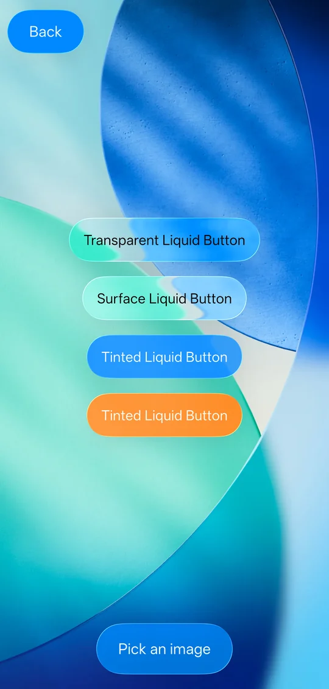
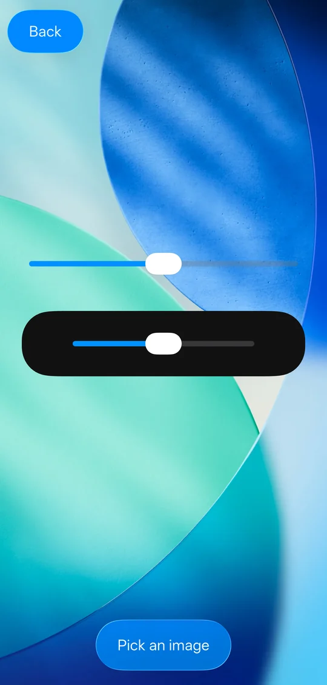
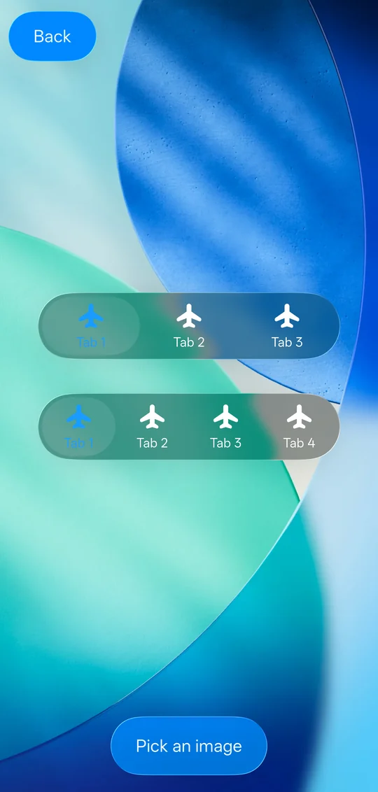
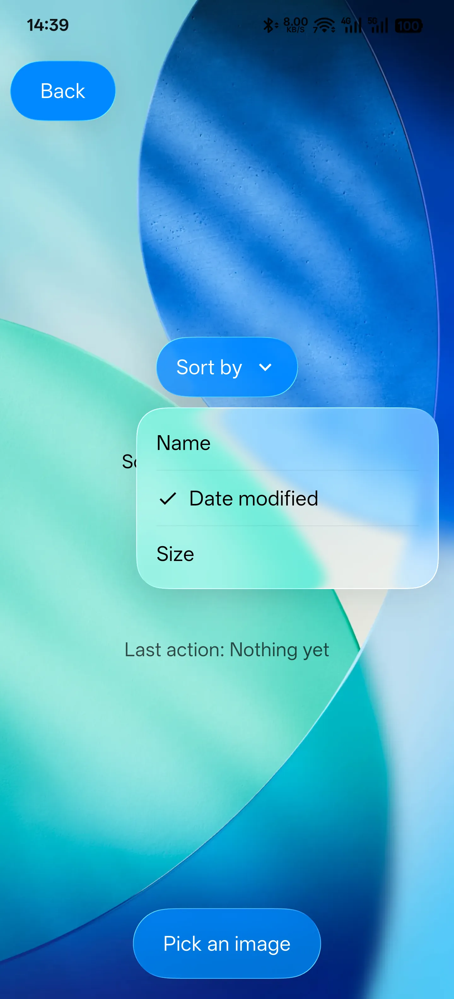
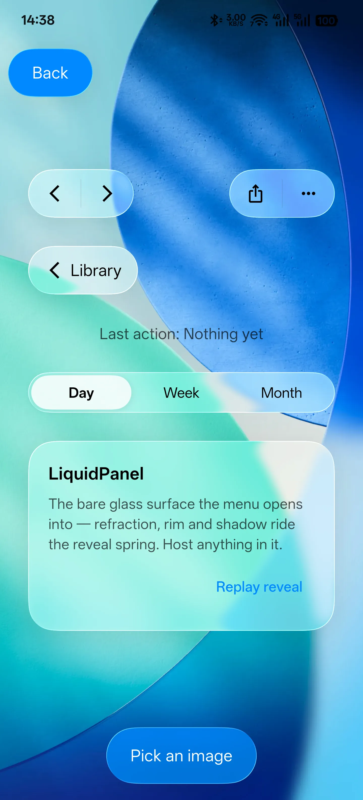
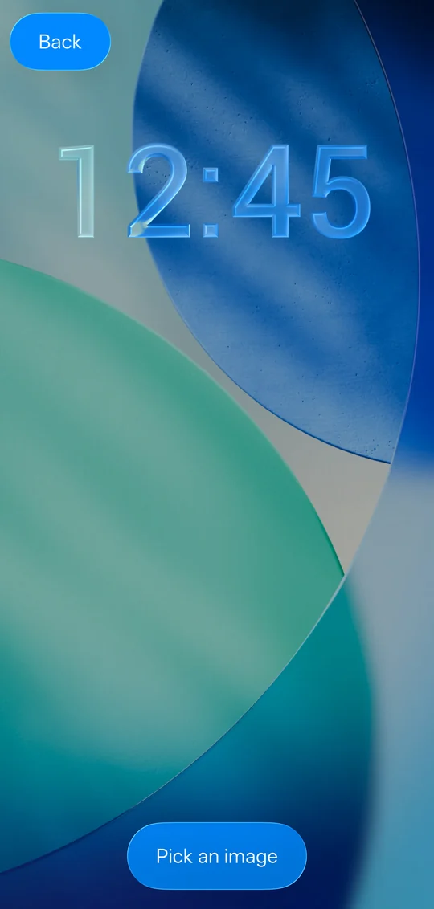
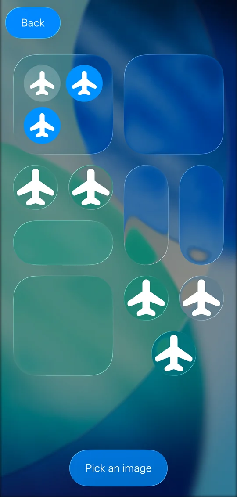
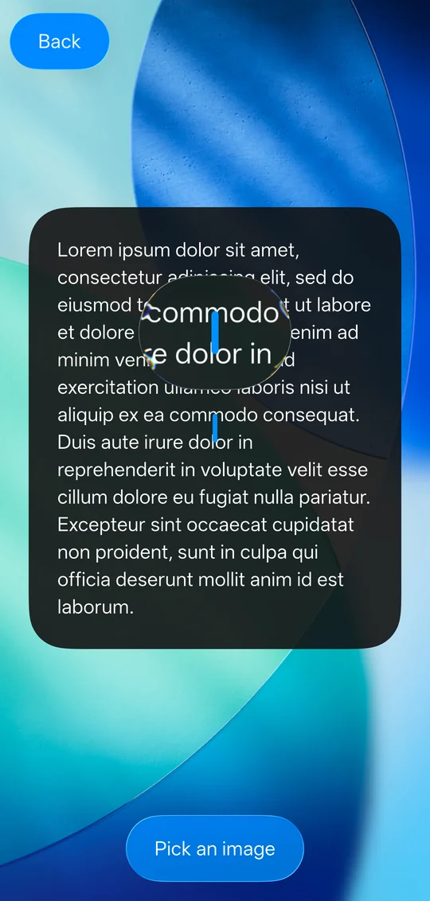
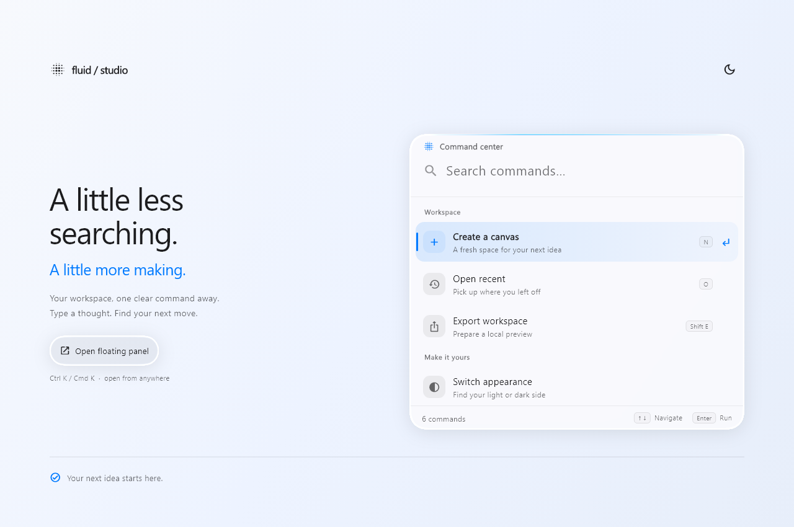

# FluidGlass

A customizable Liquid Glass effect library for Flutter — a port of
[Kyant0/AndroidLiquidGlass](https://github.com/Kyant0/AndroidLiquidGlass)
(`backdrop`) together with the continuous-corner shapes from
[Kyant0/Shapes](https://github.com/Kyant0/Shapes).

The refraction, dispersion, highlight and shadow maths are carried over from the
original AGSL and Kotlin sources unchanged, so a given set of parameters
produces the same picture on both platforms. See
[THIRD_PARTY_NOTICES.md](THIRD_PARTY_NOTICES.md) for the file-by-file mapping.

## The demo

Captured on a 1440x3168 device. `example/` is the Backdrop Catalog, with
screens for buttons, toggle, slider, bottom tabs, menu, dialog, lock screen (SDF
texture), control centre, magnifier, glass playground, adaptive-luminance
glass, progressive blur and the two scroll containers.

| Buttons | Slider | Bottom tabs |
| --- | --- | --- |
|  |  |  |

| Menu | Toolbar & controls | Lock screen |
| --- | --- | --- |
|  |  |  |

| Control centre | Magnifier |
| --- | --- |
|  |  |

## Requirements

The refraction and highlight effects run on fragment shaders through
`dart:ui`'s `ImageFilter.shader`, which needs the **Impeller** renderer. On a
backend without it, `isRuntimeShaderSupported()` returns false and glass
elements fall back to their blur/tint appearance instead of throwing.

## Usage

Wrap whatever the glass should refract in a `BackdropLayer`, then draw glass
over it:

```dart
final LayerBackdrop backdrop = LayerBackdrop();

Stack(
  children: <Widget>[
    Positioned.fill(
      child: BackdropLayer(
        backdrop: backdrop,
        child: Image.asset('wallpaper.webp', fit: BoxFit.cover),
      ),
    ),
    Center(
      child: DrawBackdrop(
        backdrop: backdrop,
        shape: () => const Capsule(),
        effects: (BackdropEffectScope scope) => scope
          ..vibrancy()
          ..blur(2)
          ..lens(12, 24),
        onDrawSurface: (Canvas canvas, Size size) => canvas.drawRect(
          Offset.zero & size,
          Paint()..color = const Color(0x40FFFFFF),
        ),
        child: const Padding(
          padding: EdgeInsets.symmetric(horizontal: 16, vertical: 12),
          child: Text('Liquid Glass'),
        ),
      ),
    ),
  ],
)
```

`FluidGlass.ensureInitialized()` preloads the fragment programs; awaiting it in
`main` avoids one unrefracted first frame. It is optional — they load on first
use either way.

### Components

Ready-made liquid-glass widgets, if you would rather not assemble one from
`DrawBackdrop` yourself. They take the same `Backdrop` handle and otherwise
drop into ordinary layout:

```dart
Column(
  children: <Widget>[
    LiquidButton(
      backdrop: backdrop,
      onPressed: () {},
      child: const Text('Press me'),
    ),
    LiquidToggle(
      backdrop: backdrop,
      selected: isOn,
      onSelect: (bool value) => setState(() => isOn = value),
    ),
  ],
)
```

| Widget | |
| --- | --- |
| `LiquidPanel` | The plain glass surface. Host anything — a card, a popover, a sheet. |
| `LiquidCommandPalette` | A complete command center: grouped search, keyboard navigation, touch targets, async execution and retry. Use inline or present with `showLiquidCommandPalette`. |
| `LiquidTextField`, `LiquidSearchField` | Native text editing and IME, Form validation/save/reset, controller ownership, search clearing and optional debounce. |
| `LiquidCheckbox`, `LiquidRadioGroup<T>` | Controlled choices with labels, mixed/disabled states and native keyboard/semantic behavior. |
| `LiquidChoiceChip`, `LiquidFilterChip` | Exclusive-choice and independent-filter building blocks for responsive `Wrap` layouts. |
| `LiquidSelect<T>`, `LiquidSelectFormField<T>` | Typed searchable selection, either controlled by your model or owned by a Form. |
| `LiquidSettingsSection`, `LiquidSettingsTile` | Shared glass grouping and general information/navigation rows. |
| `LiquidSwitchTile`, `LiquidSliderTile` | Accessible labeled settings, single row activation, units and change lifecycle hooks. |
| `LiquidNotice`, `LiquidProgress`, `LiquidEmptyState` | Inline recovery, continuous/cancellable progress and a useful next action when there is no content. |
| `showLiquidToast` | Themed notifications using ScaffoldMessenger's native queue, actions and dismissal. |
| `LiquidButton` | A capsule that squashes and slides under the finger. A square one (`height` with `padding: EdgeInsets.zero`) is a circle; `onPressed: null` disables it. |
| `LiquidButtonGroup` | A row of actions sharing one pane of glass. |
| `LiquidMenu` | A pop-up menu that blooms out of its anchor. Flips side rather than hanging off an edge; `margin` keeps it clear of one, `rootOverlay` escapes a nested navigator's overlay. |
| `LiquidBottomTabs` | A tab bar whose selection pill can be dragged. |
| `LiquidSegmentedControl` | A segmented control with a draggable thumb. |
| `LiquidSheet` | A half-screen sheet: grab handle, title, rows with a trailing check. `showLiquidSheet` presents it. |
| `LiquidDialog` | A centred modal: title, message, and the actions that answer it. `showLiquidDialog` presents it, on `nativeBackdrop` by default. |
| `LiquidMagnifier` | A loupe. Samples through a scaled canvas, so the rim refracts already-magnified pixels; `focalOffset` is what it looks at. |
| `LiquidAdaptivePanel` | A panel that measures the luminance under it and retunes brightness, contrast and blur to stay legible. `BackdropLuminance` is the measuring on its own. |
| `LiquidSlider` | A slider that stretches as it is pulled. |
| `LiquidToggle` | A switch whose knob squashes into the track. |

Two things they need that an ordinary widget does not:

- **A `Backdrop`**, passed explicitly for the original effect primitives. The
  new input and settings components default to `nativeBackdrop` for easy use.
  There is no inherited lookup; a glass
  widget cannot invent what it refracts. If threading it through gets tedious,
  put the `LayerBackdrop` in an `InheritedWidget` of your own.
- **`clipBehavior: Clip.none`** on any enclosing `Stack`. Glass paints its rim
  and shadow outside its own box, and Flutter's `Stack` clips by default.

#### Input and accessibility

The [UI essentials guide](doc/component-kit.md) covers all 15 new widgets and
the toast helper, with working form/settings examples and state ownership
contracts. Try **UI essentials · forms, choices & feedback** in the catalog:
mist white and system blue, light/dark appearance, responsive forms, a searchable
selector, cancellable save feedback and project filters with an empty state.

`LiquidSelect` is controlled; `LiquidSelectFormField` follows native
`initialValue`/Form reset behavior. External controllers and focus nodes remain
application-owned. New components preserve native input/keyboard semantics,
disable through explicit state or null selection callbacks, and support reduced
motion. Set both theme `accent` and `toggleAccent` for a single brand color.

`LiquidButton` accepts either a single `child` or a spaced `children` row.
A single child receives the available width, and `height` is a minimum so
large labels can wrap and grow within the parent's constraints. Use `Flexible`
explicitly when composing long labels inside the `children` row.
Add `tooltip` to describe an icon-only action. Buttons, toggles, sliders and
segmented controls accept `focusNode` and `autofocus`, participate in Tab
traversal and show a border when focused from the keyboard. Enter and Space
activate buttons and toggles; arrows adjust sliders and segmented controls,
with Left/Right following text direction. Home and End select either endpoint.

Disable a control by passing a null action: `onPressed`, `onSelect`,
`onValueChanged` or `onSelected`, respectively. Disabled controls retain their
state for screen readers and cannot activate from any input method. An empty
slider range is also disabled. Use `semanticLabel` on toggles and sliders to
name the setting.

```dart
LiquidSlider(
  backdrop: backdrop,
  value: volume, // The default range is 0..1.
  onValueChanged: (double v) => setState(() => volume = v),
  onChangeEnd: saveVolume, // Persist after a completed adjustment.
  semanticLabel: 'Volume',
  semanticFormatterCallback: (double v) => '${(v * 100).round()} percent',
)
```

`onChangeStart` runs before an adjustment; `onChangeEnd` runs once on normal
release or a completed track tap, keyboard step or screen-reader adjustment.
Cancelling a drag or disabling it midway does not call `onChangeEnd`. Values
already delivered by `onValueChanged` remain owned by the caller. Stepped
sliders report only changes to the snapped value, so tiny movements within one
step do not repeatedly rebuild the parent.

The slider reserves a 48-pixel-high input area around its 24-pixel thumb.
Set `touchTargetHeight: 24` to retain the earlier compact layout. A segmented
control fills a bounded width; inside an unconstrained Row it uses 100 pixels
per segment plus its horizontal insets. Use `Expanded` to fit the available
space.

See [performance and component design notes](doc/optimization.md) for the
rendering changes, verification commands and device-profiling limits.

#### Command center

A complete action surface with its own quiet visual language: a single glass
shell, a fine accent seam and a spring-driven selection beam. The search field
stays in place while results crossfade; the beam can reverse midway through a
movement without snapping. The catalog's **Command center · fluid studio**
screen demonstrates the inline and floating forms, light/dark appearance,
Ctrl/Cmd K, loading and recoverable failure.

```dart
final command = await showLiquidCommandPalette(
  context: context,
  commands: const <LiquidCommand>[
    LiquidCommand(
      id: 'create',
      label: 'Create a canvas',
      description: 'A fresh space for your next idea',
      icon: Icons.add_rounded,
      group: 'Workspace',
      keywords: <String>['new', 'design', '创建'],
    ),
    LiquidCommand(
      id: 'settings',
      label: 'Appearance',
      group: 'Preferences',
      icon: Icons.contrast_rounded,
    ),
  ],
);
if (!context.mounted || command == null) return;
// Navigate or update your application using command.id.
```

Supply an asynchronous `onSelected` to run an operation before closing; failures
stay in the palette with a Retry action. Navigate after the returned future so
the palette closes before the next route opens. Pass the launcher's global
`origin` rectangle to unfold the panel from it and fold it back on dismissal.
`nativeBackdrop` is the default; pass an existing `LayerBackdrop` for refraction.

The inline `LiquidCommandPalette` takes the same command data and a required
`onSelected`. It supports application-owned input controllers and focus nodes,
localized `LiquidCommandPaletteLabels`, and per-instance accent/surface colors.
Command IDs must be unique; command lists and keyword lists are immutable
inputs. Shortcut strings are display hints; register application shortcuts with
Flutter's `Shortcuts`/`Actions`, as the example does.



See [command center design and behavior](doc/command-palette.md) and the
[component roadmap](doc/component-roadmap.md) for the design decisions and
remaining opportunities for the library.

#### Colours

The glass is colourless — it refracts what is behind it. What needs a colour is
what is drawn *on* it: the tint that keeps a surface legible over busy content,
the accent a selection is marked in, the text of a row. `LiquidGlassTheme`
supplies all of it; without one, every component falls back to the iOS-like
palette it used to inline, resolved off the enclosing `Theme`'s brightness.

```dart
LiquidGlassTheme(
  colors: LiquidGlassColors.forBrightness(Theme.of(context).brightness)
      .copyWith(accent: brandCoral),
  child: child,
)
```

| Field | Drawn by |
| --- | --- |
| `accent` | `LiquidBottomTabs`' selection pill, `LiquidSlider`'s filled track |
| `toggleAccent` | `LiquidToggle` when on — separate because a switch reads as on/off, not as selected |
| `container` | The tint over the refracted backdrop; carries its own alpha |
| `content` | Text and icons on the glass |
| `track` | The unfilled part of a slider's and a toggle's track |
| `destructive` | A `LiquidMenuItem` marked `isDestructive` |

Per-element overrides still win where a component has one — `LiquidPanel`'s
`surfaceColor`, for instance — so one odd-coloured surface does not need a theme
of its own.

The machinery they are built from is exported too, for building your own in the
same idiom: `SpringValue` and `springOf` (the Flutter counterpart of Compose's
`Animatable<Float>` and `spring()`), `DampedDragAnimation`, `DragInspector` (a
slop-free press that never swallows a tap) and `InteractiveHighlight` (the glow
that follows a finger).

### Quality tiers

The refraction is the expensive part: a fragment shader over the element's
whole padded texture, every frame it changes. `GlassQuality` has two settings,
and that is the whole ladder — the refraction is either on or off:

| Tier | Draws |
| --- | --- |
| `GlassQuality.liquid` | Liquid glass: refraction, shaded rim, blur, tint, shadow. |
| `GlassQuality.plain` | A plain Gaussian blur behind the tint, with a flat rim. No fragment shaders, and no capture either: the chain becomes Flutter's own `BackdropFilter`. |

`GlassDeviceTier.instance` picks one **from the device, once, before the first
frame**. It is not a running measurement: the classification is synchronous, so
there is no warm-up during which the app draws at the wrong tier, and nothing
changes appearance while somebody is using it.

What the built-in classifier reads, in order:

1. **Runtime shader support.** Without `ImageFilter.shader` neither the
   refraction nor the shaded rim can run, so the tier is `plain` whatever else
   is true. Capability, not a guess.
2. **A 32-bit process.** A 32-bit mobile device is entry-level or old.
3. **Fewer than 6 processors**, when the count is known at all. Crude — core
   count is a poor proxy for GPU class — but it is the only CPU-class signal
   Dart exposes without a plugin.

That is genuinely all a Flutter app can know about a device with no
dependencies. `Platform.operatingSystemVersion` returns a build string
(`PKJ110_16.0.10.501(CN01)` on one phone) that no library should try to parse,
and judging by pixels × refresh rate moves the wrong way — a flagship has more
of both *and* fills them better, so demand alone would downgrade exactly the
devices that can afford the effect. `GlassDeviceInfo` exposes it anyway, for a
classifier that wants it.

So if your app knows better — `device_info_plus`, remote config, a user
setting — tell it, and it takes effect immediately:

```dart
// Replace the decision wholesale.
GlassDeviceTier.instance.classifier = (GlassDeviceInfo info) =>
    myDeviceIsCheap ? GlassQuality.plain : GlassQuality.liquid;

// Or just pin one.
GlassDeviceTier.instance.pinnedQuality = GlassQuality.plain;

// A subtree — a "reduce visual effects" setting, say.
GlassQualityScope(quality: GlassQuality.plain, child: child)

// One element, whatever the rest of the app is doing.
DrawBackdrop(quality: GlassQuality.liquid, ...)
```

`GlassDeviceTier.instance.describe()` says why it decided what it did.
Everything is clamped by the backend: a Skia build or the web is pinned to
`plain` however fast the device is.

**`plain` does not sample the backdrop at all.** Dropping the refraction is only
half a fallback: the lens is a fragment pass over the element's own texture,
while the capture is an `OffsetLayer.toImageSync` of the whole source that
flushes the pipeline mid-frame — and for a backdrop that changes every frame the
capture *is* the cost. So the cheap tier hands the effect chain to Flutter's own
`BackdropFilter` and lets the engine filter what is behind in place: no capture,
no stall, no texture held alive, and nothing that can go stale. The blur is the
engine's separable, downsampled Gaussian, which is the fastest one reachable
from Dart — a hand-written blur would have to go through `ImageFilter.shader`, a
per-pixel fragment program with neither separability nor downsampling.

It cannot replace the liquid tier: a fragment shader inside a backdrop filter is
handed the whole screen rather than the element's texture, so the lens would
have no geometry to anchor to. The tier that gave up the shaders is exactly the
tier that can use it. It also steps aside for anything the compositor cannot do
— a `CanvasBackdrop` or `WrappedBackdrop` the element has to draw itself, an
`onDrawBackdrop` that transforms the drawing, an `exportedBackdrop` handed back
as a picture — and those keep sampling on every tier. Wrap a screen in Flutter's
`BackdropGroup` and sibling glass shares one read of the backdrop instead of
each taking its own.

A source that changes needs nothing special, whichever way it changes:

- **It repaints.** Ordinary widgets: the repaint reaches the `BackdropLayer`.
- **It scrolls.** `RenderViewport` is a repaint boundary, so a scrolling list
  repaints without its ancestors repainting at all; `BackdropLayer` picks up the
  scroll notifications coming out of its own subtree instead, before the frame
  is built.
- **It repaints behind a repaint boundary of its own** — a
  `RepaintBoundary`-wrapped animation, a custom painter on its own ticker. That
  reaches nobody, so the captured *layers* are watched: a repaint replaces the
  `ui.Picture` of every layer it touches, which makes walking them an exact
  answer to "did anything in here change".
- **It only moves.** A page sliding in, an `InteractiveViewer` being panned or
  pinched. Nothing repaints, so the capture is still good; where the glass has
  to read it is what changed, and that is the whole matrix between the two —
  which is why glass over a zoomed photo magnifies by exactly as much as the
  photo does.

Pass `liveness` when something already knows the content is about to change —
an `AnimationController`, a `ValueNotifier`. It is not required, but it drops
the capture *before* the frame is built rather than after it has been drawn,
which is one frame earlier than any after-the-fact watch can manage:

```dart
BackdropLayer(backdrop: backdrop, liveness: myController, child: source)
```

What Flutter does not draw itself it also cannot capture. A video texture, a
camera preview or a native map inside the source comes out as a hole in the
glass; those have to sit outside the `BackdropLayer`.

Wrap **only what the glass should refract**, and put the glass over it as a
sibling. Glass placed inside the subtree would be part of what it is trying to
refract — the capture would be taken while the source was halfway through
painting, and the two would mark each other dirty every frame — so that is
reported as an error rather than drawn wrong.

A live source is not free, and it is worth knowing what the cost actually is.
Flinging a feed under pinned glass chrome on a 120 Hz phone, mean ms per frame,
**as measured before captures were limited to the regions the glass reads**:

|                  | raster | build | total |
| ---------------- | ------ | ----- | ----- |
| no glass at all  | 0.73   | 0.20  | 1.49  |
| glass, capture 1 | 1.46   | 0.68  | 14.17 |
| glass, capture ½ | 2.05   | 1.20  | 5.37  |

Raster and build were both tiny, and `totalSpan` twelve milliseconds larger
than the two together — the cost was the stall from `toImageSync`, a
synchronous capture in the middle of a frame, and it scaled with the pixels
captured rather than with how much glass was drawn. That is what region capture
fixed: a pinned bar now captures the strip it reads, not the page. Measured
again since, the capture is no longer the larger cost — the glass draw is — and
halving `BackdropLayer.pixelRatio` cuts the stall by about two milliseconds and
gives the same back in raster, upscaling the smaller texture. So do not reach
for `pixelRatio` first on a scrolling source; measure `totalSpan`, not raster
time alone, before and after. Turning off `addRepaintBoundaries` on the list
made no difference either way, in case that was the next guess.

Three things keep that cost down without touching a pixel at rest. A request is
captured together with any region it overlapped last frame, so glass elements
reading the same strip through slightly different paddings share one capture. A
change to the source that lands nowhere under any glass — a spinner, a marquee
or a carousel at the top of a page whose glass is a bar at the bottom — is seen
and left alone, because the watch knows where each picture draws. And
`BackdropLayer.motionPixelRatio` captures at a lower resolution only while the
source is changing on consecutive frames, with a full-resolution capture the
frame after it stops: sharp at rest, where sharpness shows, and cheap in motion,
where it does not.

```dart
BackdropLayer(
  backdrop: backdrop,
  motionPixelRatio: MediaQuery.devicePixelRatioOf(context) * 0.5,
  child: page,
)
```

A change is placed by the box of the render object that repainted, and a render
object may paint past its box — a drop shadow, an overflowing `Stack` — so a
change within `BackdropLayer.changeMargin` of what the glass reads (64 logical
pixels by default) still counts as reaching it. An app whose widgets overflow
less can lower it, and a card deck sliding just above a glass bar then costs the
bar nothing:

```dart
BackdropLayer(backdrop: backdrop, changeMargin: 32, child: page)
```

`LiquidBottomTabs` adds no live capture of its own. The accent-tinted copy of
the tabs that its pill magnifies was once a second glass element captured
through a `BackdropLayer`, and the pill re-captured it on every frame it moved;
the pill now draws that copy's glass itself, over its own footprint only, and
reads the accent tab row from a capture that is taken once and held. Switching
tabs costs the panel and the pill, and no `toImageSync` between them.

The catalog's **Live background** screen is the two cases that are not a
scroll — an aurora repainting inside a `RepaintBoundary`, and a photo you pan
and pinch — with pinned glass over both. **Quality tiers & device** shows both
tiers side by side with the classification and its evidence, and **App chrome
over a live feed** is the expensive case — pinned chrome over content that repaints every frame,
where the backdrop snapshot is invalidated and re-captured on every frame of
the scroll. It is the screen to measure a change on: `pixelRatio` and
`motionPixelRatio` trade the capture's pixels against the raster time spent
upscaling them, and which side wins depends on the device — see above.

### Effects

Effects are applied in the order you call them.

| Effect | What it does |
| --- | --- |
| `blur(radius, {edgeTreatment})` | Gaussian blur. `radius` is an Android-style radius, converted internally to Flutter's sigma. |
| `lens(refractionHeight, refractionAmount, {depthEffect, chromaticAberration})` | Bends the backdrop inwards along the edge. |
| `colorControls({brightness, contrast, saturation})` | Colour matrix. |
| `vibrancy()` | `colorControls(saturation: 1.5)`. |
| `opacity(alpha)` | Scales the backdrop's alpha. |
| `colorFilterEffect(filter)` | Any `ColorFilter`. |
| `imageFilterEffect(filter)` | Any `ImageFilter`. |
| `fragmentShaderEffect(key, program, configure)` | Your own shader. |

A custom shader must declare a `vec2` first uniform (the engine overwrites it
with the input texture size) and at least one `sampler2D` (the engine binds the
chain's current output to the first one). `shaders/refraction.frag` is a
worked example.

### Decoration

`DrawBackdrop` draws, in order: the drop shadow, `onDrawBehind`, the filtered
backdrop, `onDrawSurface`, the `child`, `onDrawFront`, the highlight rim and the
inner shadow. Everything from `onDrawBehind` to `onDrawFront` is clipped to
`shape`.

- `highlight` — `Highlight.standard` (lit from 45°), `Highlight.ambient`
  (white on the lit side, black on the other) or `Highlight.plain`.
- `shadow` — `GlassShadow`, punched out under the element so it never darkens
  what the glass shows.
- `innerShadow` — `GlassInnerShadow`, which reads as thickness.

Pass `null` for any of them, or use `DrawBackdrop.plain` to drop all three.

The two shadows are baked into cached textures and re-baked only when their
*geometry* changes, so animating their `alpha` costs nothing per frame —
animating a `radius` still re-bakes, and the cache detects that and steps back
to drawing directly. The highlight rim is never baked: it is a hairline, and
resampling a cached copy of it is visible.

`isolateSurface` (default true) gives `onDrawSurface` its own save-layer, so
blend modes it uses composite against the refracted backdrop alone. A surface
that only paints src-over produces identical pixels without it — pass false to
save an offscreen pass per frame.

### Animating

`shape`, `effects`, `highlight`, `shadow`, `innerShadow` and `layerBlock` are
evaluated during paint, so they can read animation values directly. Give
`DrawBackdrop` a `repaint` listenable and it repaints without rebuilding:

```dart
DrawBackdrop(
  backdrop: backdrop,
  shape: () => const Capsule(),
  effects: (BackdropEffectScope scope) =>
      scope.lens(10 * animation.value, 14 * animation.value),
  layerBlock: (GlassLayer layer) => layer.scaleX = animation.value,
  repaint: animation,
  child: child,
)
```

`layerBlock` transforms the element *and* counter-transforms what it refracts,
so scaling a glass element does not scale the image inside it.

#### The press motion, without the glass

`LiquidPressDeformation` is the displacement law the pressable components move
by — a swell while the element is held, a `tanh`-bounded lean towards the
finger, a stretch along the axis being pulled — as four plain numbers. It is
what `LiquidButton` writes onto its glass layer, and it is public so that
something which is not made of glass can move by exactly the same law:

```dart
final LiquidPressDeformation press = LiquidPressDeformation.resolve(
  size,
  offset: highlight.offset,          // travel since the pointer went down
  pressProgress: highlight.pressProgress,
);

Transform(
  alignment: Alignment.center,
  transform: press.transform,
  child: child,
)
```

Feed it from springs, not from raw pointer values — the squash and the
ring-down are the springs' doing, not the law's. `InteractiveHighlight` carries
the pair the components use, and `SpringValue` builds your own.

Note that `InteractiveHighlight.wrapGestures` and `DragInspector` stay out of
the gesture arena, which is what lets a press survive a drag; inside a
`Scrollable` that also means the press is not released when the scroll claims
the pointer, and the tap still fires on the lift. Where an ancestor may claim
the gesture, drive the highlight from your own arena-aware handler — a
`GestureDetector`'s `onTapDown`/`onTapCancel`, or a Material button's
`statesController` — and keep a `Listener` only for the position.

### Backdrops

| Backdrop | Source of pixels |
| --- | --- |
| `LayerBackdrop` + `BackdropLayer` | A live capture of another part of the tree. |
| `CanvasBackdrop(onDraw)` | A canvas callback, for cheap backgrounds. |
| `CombinedBackdrop.of(a, b, …)` | Several backdrops, drawn in order. |
| `WrappedBackdrop(inner, onDraw)` | Another backdrop, transformed as it is drawn. |
| `nativeBackdrop` | Whatever the compositor already painted beneath the element — a `BackdropFilterLayer`, no capture. For chrome that sits *over* what it filters. |
| `emptyBackdrop` | Nothing. |

`DrawBackdrop.exportedBackdrop` fills a `LayerBackdrop` with the element's own
drawing, so glass nested inside it can refract the glass around it.

### Shapes

`Rectangle`, `RoundedRectangle(radius)`, `Capsule()` and
`UnevenRoundedRectangle` default to G2-continuous ("squircle") corners; pass
`style: RoundedCornerStyle.circular` for plain circular ones. `GlassShapeClipper`
and `GlassShapeBorder` adapt them to `ClipPath` and `ShapeDecoration`.

## Running the demo

```sh
cd example
flutter run
```

Setting `FLUID_GLASS_SHOT=<dir>` renders every screen to a PNG and exits, which
is how the screens were checked against the originals;
`FLUID_GLASS_SHOT_SCALE` sets the pixel ratio they are rendered at.

## Implementation notes

Flutter has no modifier chain, so the glass, highlight, shadow and inner shadow
are one render object, drawn in that order. Two details are shaped by the
engine:

- `ImageFilter.shader` is handed the whole input texture, which a preceding blur
  in the same filter would have grown, so each shader effect gets its own
  save-layer. The effect output is therefore clipped to the element's bounds.
- `LayerBackdrop` captures its source once per frame with
  `OffsetLayer.toImageSync`, and every glass element that reads it samples that
  one image. The capture clips hard at the source's bounds — Compose records
  the source's draw commands unclipped — so a transform that shifts content
  past those bounds must sit *outside* the `BackdropLayer`, or the shifted
  edge is sheared off in every glass element that samples it.
- Skia caches blurred masks by path and sigma; Impeller does not, so the
  highlight, shadow and inner shadow are baked into cached textures instead of
  being re-blurred every frame.

## Licence

Apache License 2.0 — see [LICENSE](LICENSE) and [NOTICE](NOTICE). FluidGlass is
a derivative work of two Apache-2.0 projects by
[Kyant](https://github.com/Kyant0);
[THIRD_PARTY_NOTICES.md](THIRD_PARTY_NOTICES.md) records which files derive from
which originals.

### Fusing controls — one body of glass

```dart
LiquidFusionScope(
  backdrop: backdrop,
  child: Row(spacing: 8, children: <Widget>[back, title, more]),
)
```

Controls inside a scope stop drawing their own glass and their own light, and
hand the scope three things instead: where they are, how round they are, and
what their press is doing this frame. The scope draws all of them as a single
element. Nothing is configured at the controls — a `LiquidButton` in a scope is
the same `LiquidButton` as anywhere else.

Two things become shared, on different terms:

* **The shape, once they are close.** The silhouette is a field, not an outline:
  each shape contributes a signed distance, the shader takes their smooth
  minimum, and the result bulges towards its neighbour before the two touch,
  grows a concave neck, and swallows it. A union of two paths gives none of that.
* **The light, as far as the body reaches.** The rim runs around the whole body
  rather than around each part. The press is the control being operated, so the
  glow stays in the connected body the finger is in: drag along a merged pair
  and it travels through the neck, drag towards a control that has not merged
  and it stops at the gap — a separate control is not the one being pressed.
  Which shapes count as one body is worked out per frame, from the same gap
  arithmetic that sets the smoothing.

`LiquidNavigationBar` does *not* use a scope: a centred title puts its three
islands far too far apart to ever merge, so they stay three pieces of glass
with three samples of the backdrop.

The default `smoothing` of 10 is the balance point between merging and the
press, and it was measured. A fused field closes over a gap of about half the
smoothing, so 10 bridges at 5 logical pixels: a row of controls 8 apart still
reads as a row at rest, and the press — which swells a held control by 4px on
its short axis and leans it towards the finger by a twentieth of the drag — is
what closes the rest. Press one control towards its neighbour and they bridge.

It is also one glass element rather than one per control: a single capture of
the backdrop and a single shader pass for the group. Wrap the group, not the
page — the scope box is what gets captured and shaded, and controls in
different scopes share nothing. One body is one surface, so a member's own
`surfaceColor` and `tint` do not survive joining it; colour the scope instead,
and keep an accented primary action outside it. Up to eight controls. On a
device with no runtime shaders every control draws its own glass as before.

`LiquidFusion` is the explicit form for a caller that owns the geometry, taking
`LiquidBlob`s and an optional `LiquidFusionPress`. Either form leaves headroom
around the shapes for what the field does outside them — a press swells a held
control past its own box, and a box with no headroom clips the swell square. The catalog's Fusion screen
is three ordinary buttons: hold one to see the light cross the group, drag two
together to merge them.

### Shared press feedback and navigation

Set `ThemeData(splashFactory: LiquidInkHighlight.splashFactory)` in both light
and dark themes to apply soft press feedback to Material ink controls throughout
the app. Glass buttons retain their finger-following glow. Wrap custom content in
`LiquidInteraction(child: ...)`; it observes input without replacing the child's
action. Its `selected` flag keeps an accent wash, while `active` can be driven by
a parent for drag selection. Use `trackPointer: false` for parent-controlled rows.

The glow stays as long as the finger does and follows it, clamped to the
control — it does not die at the first 18 pixels of travel the way a Material
ink does. Give a `LiquidInteraction` an `onTap` and it becomes a slop-free
control of its own, firing on a lift inside its bounds. Put several inside a
`LiquidInteractionGroup` and one finger serves all of them: the member under
it lights up, sliding onto a neighbour moves the light and the press, and
lifting fires whichever member the finger is on by then — the rule a fused body
already follows for its light, applied to what the finger does. A scroll of the
list the members sit in cancels the press. Members hand their tap to `onTap`
and nothing else, or a plain tap fires twice. `LiquidNavigationBar` follows the
same rule on its own: press one island, slide to another, lift, and the island
under the finger is the one that fires.

Toolbar button groups use transient press glow and spring feedback without a
persistent selection wash. Segmented controls accept drags starting
on any segment, commit on release, and restore their selection on cancellation.
Menus support dragging between rows and long-pressing the anchor to slide into
the menu. Releasing outside a row cancels selection. Opening has a light spring
overshoot, closing settles directly, and menus honor reduced-motion settings.

```dart
// Place above a BackdropLayer in a Stack; let the content scroll underneath.
LiquidNavigationBar(
  backdrop: backdrop,
  leading: LiquidNavigationAction(
    backdrop: backdrop,
    icon: Icons.arrow_back_ios_new,
    label: 'Back',
    onPressed: () => Navigator.maybePop(context),
  ),
  titleLeading: const CircleAvatar(radius: 16),
  title: const Text('Mika'),
  onTitlePressed: openProfile,
  trailing: moreButton,
)
```

Top chrome as three floating islands of glass rather than one bar: a round
leading action, a title island that hugs its content, a round trailing action.
Only what carries text is covered, so the content keeps scrolling visibly
between them. What stops the gaps reading as holes is the scrim behind
them — `scrimColor`, defaulting to the enclosing `ColorScheme.surface` — opaque
behind the status bar and gone `fadeHeight` below the islands, so there is no
hard edge anywhere. The two side slots are the same width whatever they hold,
which is what keeps the title centered on the screen rather than between its
neighbours. `titleLeading` puts an avatar in the island and `onTitlePressed`
makes it a button, the way a chat header opens the profile it names. When the
chrome does not read against a particular app's content, reach for
`blurRadius` before `surfaceColor`: legibility comes from the blur under the
glass, and raising the tint's alpha instead is how glass turns into a grey bar.
The bar includes the top safe area; use `includeTopPadding: false` when the
parent already supplies SafeArea. Only the islands take input: the scrim does not
intercept touches, so content under it still scrolls and still takes taps. The
catalog's Navigation bar screen is the chrome on its own — take the scrim to
zero to see what it is for, put the avatar in and out of the island, and tap a
row that is still half under it. App chrome shows the same chrome over a live
scrolling feed; Toolbar & controls retains the original action groups, Library
button, and Day/Week/Month picker.
