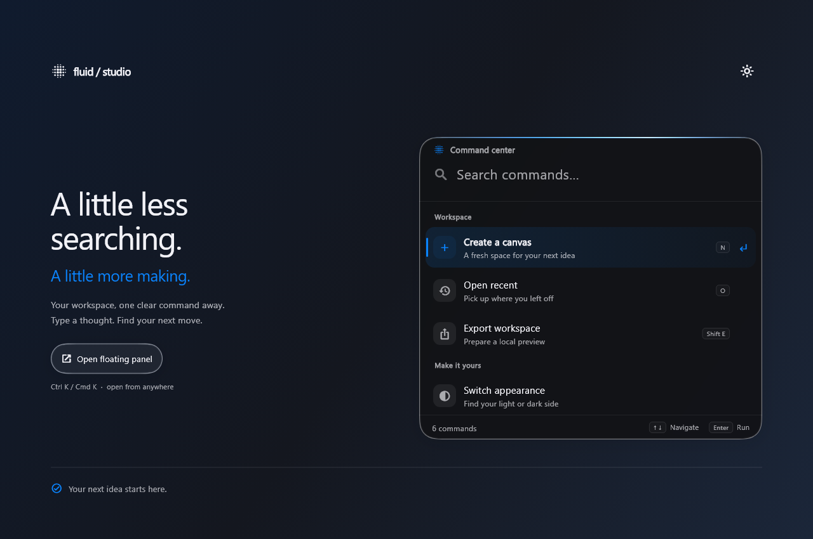

# Fluid command center

`LiquidCommandPalette` is an original composed component, built on FluidGlass's
existing surface and spring primitives. It is an action finder, rather than a
system search clone: applications supply their own command data and behavior.

## Visual direction

The glass belongs to the shell. Rows stay flat so reading a list does not mean
looking through a stack of refracting cards. A thin accent seam identifies the
surface, and a colored selection beam connects the icon, label and action.
Moderately rounded corners and a restrained information hierarchy replace the
large capsules and glossy controls of a literal iOS reproduction.

All component colors follow `LiquidGlassTheme`, with accent and surface
overrides. The catalog uses a mist-white/slate-blue palette with iOS-like blue
accents in both appearances. Auxiliary text remains readable; disabled items carry an explicit
disabled state instead of relying only on a muted appearance.

## Animation contract

- One spring moves the selection beam at paint time. Retargeting preserves its
  current position and velocity. It does not build the rows on each tick.
- Result sets crossfade and translate by only 1.5% of their viewport height.
  The input and footer keep their positions. Outgoing results cannot receive
  pointer or accessibility actions, including during rapid successive searches.
- The clear-button slot and selected-row action slot reserve their width;
  appearing controls do not shift the text beside them.
- The route unfolds from `origin` using `LiquidMorph`, with the same progress
  function on entry and exit. Closing midway reverses the current clip. The
  content is laid out once and sits in a repaint boundary during this motion.
- Busy, error and completion feedback crossfade; the footer eases to its new
  height. Busy operation starts no second command. It stops its progress ticker
  after completion or disposal.
- Keyboard insets ease the route into its available space. A short viewport
  removes the title row while preserving the keyed text field and its focus.
- `MediaQuery.disableAnimations` snaps selection, removes the result/route
  transitions and uses a static busy indicator. There is no perpetual ambient
  animation at rest.

## Behavior and ownership

Search is case-insensitive and requires every whitespace-separated query token
to match. Labels rank ahead of descriptive text and keywords. Categories remain
grouped, and equal matches retain source order. It is deterministic substring
search, not a fuzzy-search engine or automatic transliteration; add aliases and
localized terms to `keywords`. An indexed search string is built once per new
command list; visible rows are built lazily.

Up/Down move between enabled commands; Enter executes once. Focus remains in the
search field. Escape dismisses a modal or clears an inline palette without an
`onDismiss`. Home/End, selection shortcuts and IME candidate selection remain
text editing operations. Touch and screen reader actions invoke the same
execution path. Shortcut labels do not register global key bindings.

Commands are immutable descriptions with unique IDs. The application owns
business logic through `onSelected`. A thrown synchronous or asynchronous
failure produces the localized error state; `onError` can record details without
exposing the exception to end users. Retry looks up the latest command by ID.
Disposal ignores a late completion and cannot pop a later route.
Dismissing a panel does not cancel the application's future; use application
cancellation when the underlying operation needs it.

Use the future returned by `showLiquidCommandPalette` for navigation. Its
default native backdrop uses the compositor's blur/tint path. Supply a captured
backdrop explicitly when refraction is desired. As with other library modals,
the captured source and barrier dim may look different from the native path.

The studio actions are local demonstrations: canvas count, appearance and status
updates, plus a simulated export and deliberate first-attempt retry failure.
The component does not provide storage, network sync or a command registry.

## Verification

`test/command_palette_test.dart` covers search, keyboard input, IME ownership,
semantics, async execution and disposal, 1000-command lazy construction,
selection reversal, zero widget builds on beam ticks, rapid filtering, dynamic
command lists, controller ownership, compact layout, large text and modal focus
restoration. The example tests exercise the product flow and Ctrl K.

Screenshots are real Flutter renders with system typography. Host widget tests
do not establish mobile Impeller frame rates; profile the intended device for
GPU timing.

## Interaction references

Behavior was checked against the [WAI-ARIA combobox interaction guidance](https://www.w3.org/WAI/ARIA/apg/patterns/combobox/)
and the grouping/disabled-item concepts in [cmdk](https://github.com/dip/cmdk).
These informed interaction decisions; no source code from either was copied.
The implementation uses native Flutter input and semantics rather than web ARIA.
