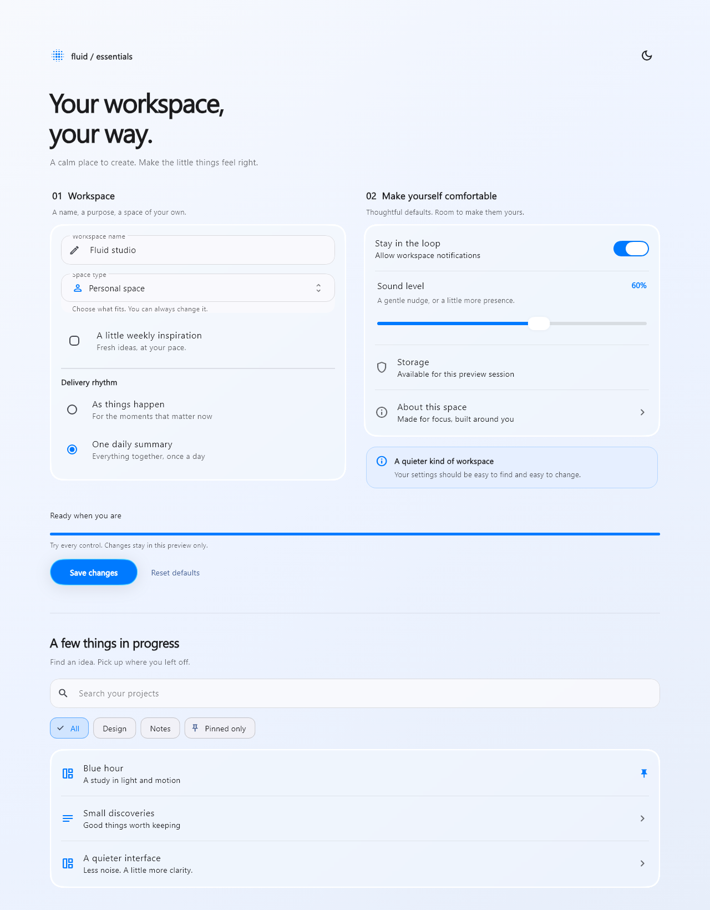
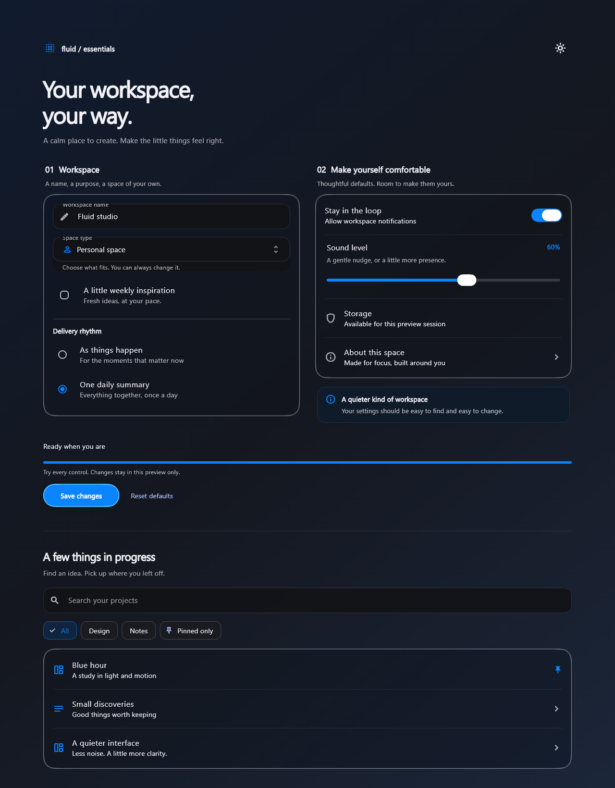

# UI essentials

FluidGlass now includes a coherent set of inputs, choices, settings and feedback
alongside its material and motion primitives. Import only
`package:fluid_glass/fluid_glass.dart`; no extra dependency is required.

Open **UI essentials · forms, choices & feedback** in the catalog. The demo uses
mist white, ink and system blue, supports light/dark appearance, and composes all
the components in an editable workspace. Save/cancel is a local asynchronous
preview; settings last only while the page is open.

```powershell
cd example
flutter run -d emulator-5554 --release --dart-define=FLUID_GLASS_SCREEN=componentKit
```

| Light | Dark |
| --- | --- |
|  |  |

## Choose the right state owner

| Component | State contract |
| --- | --- |
| `LiquidTextField` | Pass `controller` for application-owned editing, or `initialValue` for native field-owned editing. Never both. Includes native Form validation/save/reset. |
| `LiquidSearchField` | Optional borrowed controller; otherwise owns one. `onChanged` reports user edits and clearing, with optional debounce. |
| `LiquidCheckbox` | Controlled `bool?`, with optional label/helper; enable `tristate` for null/mixed. |
| `LiquidRadioGroup<T>` | Controlled typed value and a list of `LiquidSelectOption<T>`. Native group keyboard behavior. |
| `LiquidChoiceChip` | Controlled selection. Caller makes a group exclusive. |
| `LiquidFilterChip` | Controlled independent selection. Compose a multi-filter group with `Wrap`. |
| `LiquidSelect<T>` | Controlled typed value; opens a searchable modal. Dismissal leaves the value unchanged. |
| `LiquidSelectFormField<T>` | Form owns the value. Use `initialValue`, `validator`, `onSaved` and Form reset. |
| `LiquidSettingsSection` | A shared glass pane, optional title, description, dividers and footer. No business state. |
| `LiquidSettingsTile` | Information or navigation; null `onTap` means information. |
| `LiquidSwitchTile` | Controlled bool; the whole row is one action and one keyboard stop. |
| `LiquidSliderTile` | Controlled numeric value, labeled range, formatter and start/end hooks. |
| `LiquidNotice` | Caller owns visibility and recovery/dismiss callbacks. Four severities with icons. |
| `LiquidProgress` | Caller owns progress and cancellation. Null means indeterminate. |
| `LiquidEmptyState` | Message and next action; scrolls when the available height is short. |
| `showLiquidToast` | Uses the nearest `ScaffoldMessenger`, which owns queuing and dismissal. Returns its controller. |

For controlled widgets, return the new value from the callback through the
value property. They do not secretly keep a second business value. A null
callback disables selection, switch, slider and chip controls. Text/search
fields use `enabled: false`; `readOnly` text remains selectable. Null text
`onChanged` simply means the application does not need edit notifications.

External controllers and focus nodes always belong to the caller and must be
disposed by the caller. Text editing, composing regions, selection, autofill
and input formatters remain Flutter's native behavior.

## A small, working form

Keep the key in your State object. Flutter manages the editing values; your
application validates and saves them together.

```dart
enum SpaceKind { personal, studio }

final formKey = GlobalKey<FormState>();
String? savedName;
SpaceKind? savedKind;

// In build:
Form(
  key: formKey,
  child: Column(
    children: [
      LiquidTextField(
        label: 'Workspace name',
        initialValue: 'My studio',
        textInputAction: TextInputAction.next,
        validator: (value) => value == null || value.trim().isEmpty
            ? 'Enter a name'
            : null,
        onSaved: (value) => savedName = value?.trim(),
      ),
      const SizedBox(height: 16),
      LiquidSelectFormField<SpaceKind>(
        label: 'Space type',
        initialValue: SpaceKind.personal,
        options: const [
          LiquidSelectOption(value: SpaceKind.personal, label: 'Personal'),
          LiquidSelectOption(value: SpaceKind.studio, label: 'Studio'),
        ],
        onSaved: (value) => savedKind = value,
      ),
      FilledButton(
        onPressed: () {
          if (formKey.currentState!.validate()) {
            formKey.currentState!.save();
            // Persist savedName/savedKind through your application here.
          }
        },
        child: const Text('Save'),
      ),
      TextButton(
        onPressed: () => formKey.currentState!.reset(),
        child: const Text('Reset'),
      ),
    ],
  ),
)
```

`LiquidSelect` is the alternative when a provider, Bloc, model or parent State
already owns selection. It supports enums and domain objects, with unique
values under `==`; use stable equality for domain objects. A null value shows
the placeholder. Empty/all-disabled options disable the launcher. Disabled
options remain visible. If an option is removed or disabled while the chooser
is open, it cannot subsequently commit. Reopening begins at the current choice.

The current selector is single-select. Use filter chips for a small independent
set; a searchable multi-select needs its own Apply/Cancel contract and is not
silently emulated by this selector.

## Search without extra plumbing

```dart
LiquidSearchField(
  hintText: 'Search projects',
  clearLabel: 'Clear search',
  debounce: const Duration(milliseconds: 180),
  onChanged: searchProjects,
  onSubmitted: openFirstResult,
)
```

Default debounce is zero, useful for local filtering. Pending edits flush before
submission and cancel on disposal, disable, controller replacement or a newer
programmatic text change. Programmatic controller edits do not call `onChanged`,
matching TextField. Explicitly update your filter when clearing a controller
from elsewhere in the application. Debouncing does not cancel an already
started network request; your data layer still owns cancellation/result ordering.

The clear-button slot stays the same width. An empty input removes its clear
action from pointer input, keyboard traversal and screen-reader semantics.

## Settings that compose

```dart
LiquidSettingsSection(
  title: 'Notifications',
  children: [
    LiquidSwitchTile(
      title: 'Stay in the loop',
      subtitle: 'Allow workspace notifications',
      value: notifications,
      onChanged: (value) => setState(() => notifications = value),
    ),
    LiquidSliderTile(
      title: 'Sound level',
      value: volume,
      min: 0,
      max: 100,
      divisions: 10,
      formatter: (value) => '${value.round()} dB',
      onChanged: (value) => setState(() => volume = value),
      onChangeEnd: persistVolume,
    ),
  ],
)
```

Each section shares one glass pane among its rows. Chips, notices and progress
use ordinary paint rather than adding a backdrop sampler per label. Text/select
controls have quiet, readable surfaces, native focus/error strokes and default
to `nativeBackdrop`; pass `emptyBackdrop` when sampling is unnecessary or your
own backdrop when controlling a layer explicitly.

The switch row merges its label and knob into one semantic action; clicking
either or pressing Space/Enter invokes one callback. Drag gestures belong to
the standalone `LiquidToggle`, not to the setting row. Slider persistence can
run on `onChangeEnd` rather than on every intermediate value. Its default
percentage describes position within the supplied range; use `formatter` for
real units. Cancellation follows `LiquidSlider`'s lifecycle.

## Feedback and motion

```dart
LiquidNotice(
  severity: LiquidNoticeSeverity.error,
  title: 'Could not save',
  message: 'Your changes are still here.',
  actionLabel: 'Retry',
  onAction: retrySave,
)

LiquidProgress(
  value: uploadProgress, // null for unknown progress; otherwise 0..1
  label: 'Uploading files',
  onCancel: cancelUpload,
)

showLiquidToast(
  context: context, // below MaterialApp/ScaffoldMessenger and a Scaffold
  message: 'Changes saved',
  severity: LiquidNoticeSeverity.success,
  actionLabel: 'Undo',
  onAction: undoChanges, // The application performs the actual undo.
);
```

Notice severity is expressed through icon and text as well as color. Set
`liveRegion: false` for static explanatory notices. Toasts use native SnackBar
actions so queueing, close/swipe, route lifetime and accessible action timeouts
remain coordinated by Flutter. Avoid using an auto-dismiss toast as the only
place where a blocking error is explained.

Determinate progress retargets from its current displayed value; rapid changes
do not reset it to zero. It stops requesting animation frames when settled.
Search clearing fades without changing layout; chip state uses native reversible
transitions. Selectors reuse the command palette's spring selection, filtered
result crossfade and reversible launcher-to-panel morph. Decorative transitions
honor `MediaQuery.disableAnimations`; indeterminate progress becomes a static
indicator labeled “Working” rather than claiming a made-up percentage.

## Appearance and verification

Wrap the components once in `LiquidGlassTheme`. Set both `accent` and
`toggleAccent` to use the same brand blue; defaults retain the library's
existing iOS-style green switches. Pair it with your app's Material Theme so
native text actions and selections use the same palette. Contrast preferences
flow through the existing glass quality/theme fallback.

Focused regression coverage checks native IME/controller ownership, form
validation/save/reset, debounce lifecycle, mixed/disabled semantics, keyboard
radio selection, selector cancellation and changing options, one switch action
per activation, custom slider ranges, progress continuity/idle/reduced motion,
toast actions, short empty states, and a narrow two-times-text demo. Captures
show actual Flutter rendering. Widget tests check behavior and build/scheduling
costs; device profiling is still needed for hardware frame-time claims.
